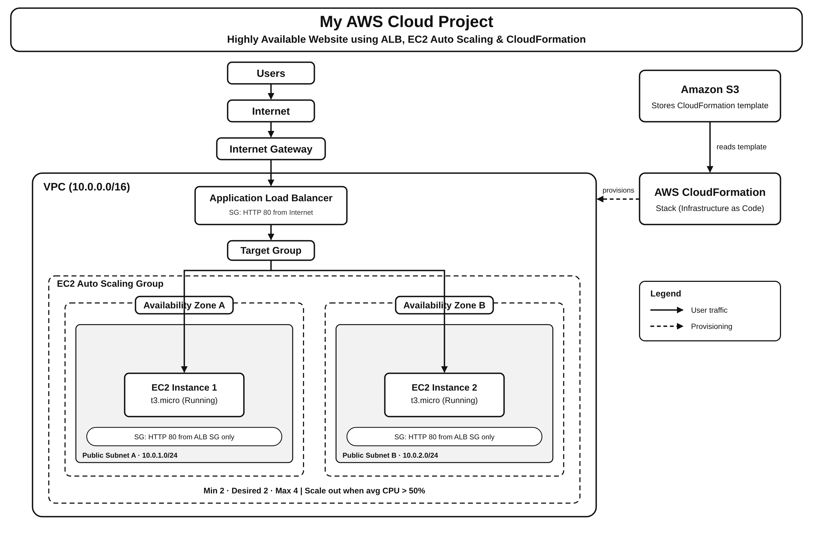
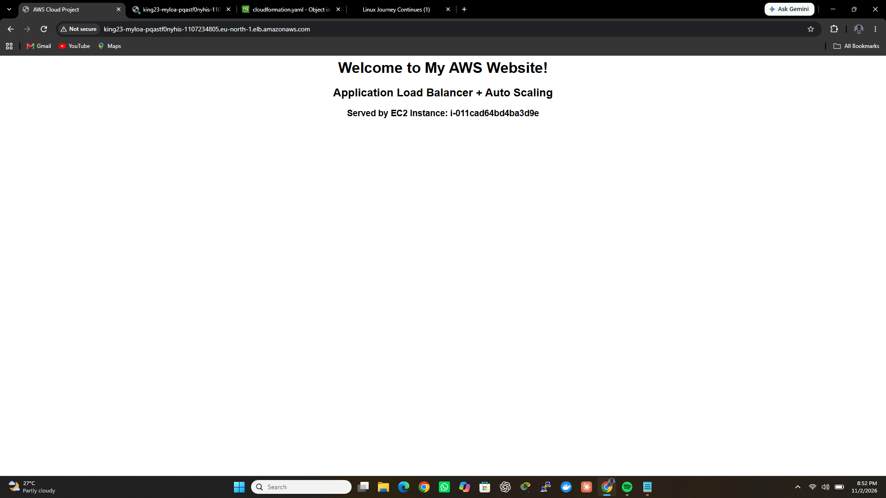
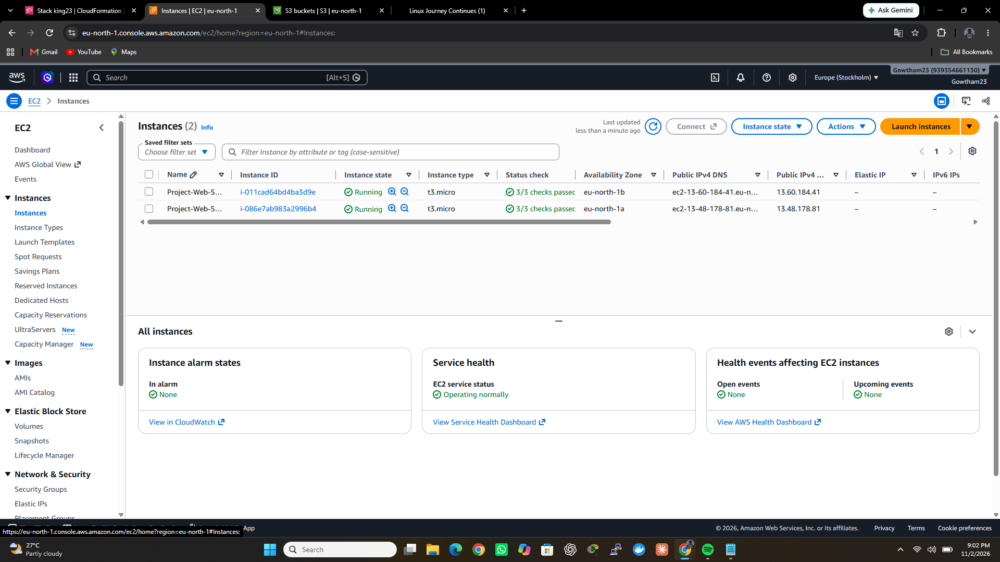
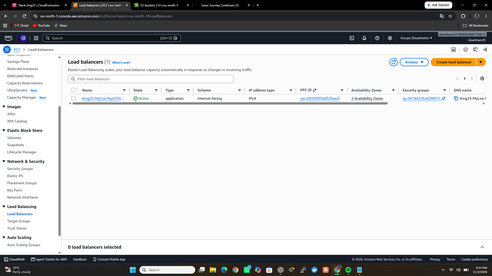
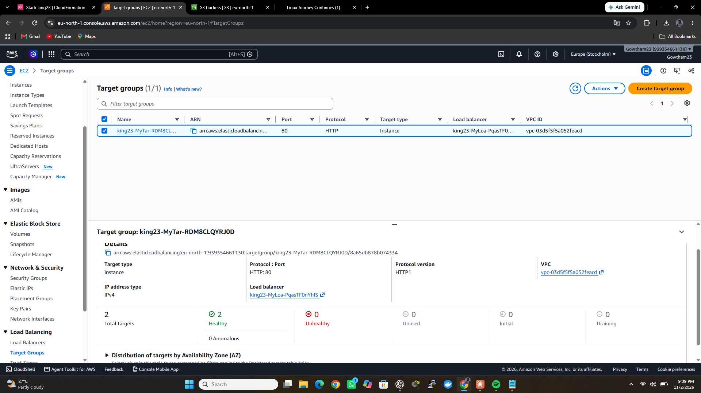
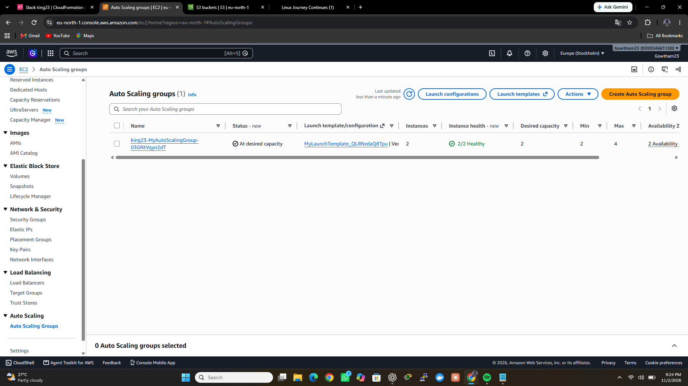
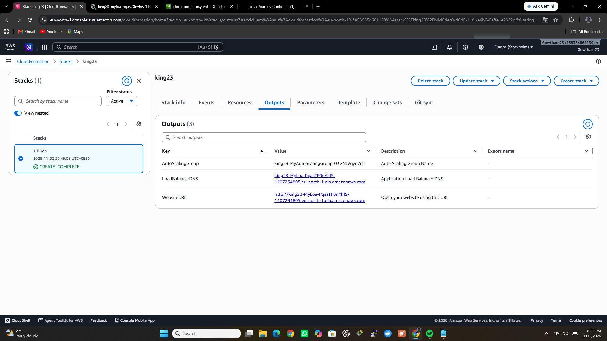
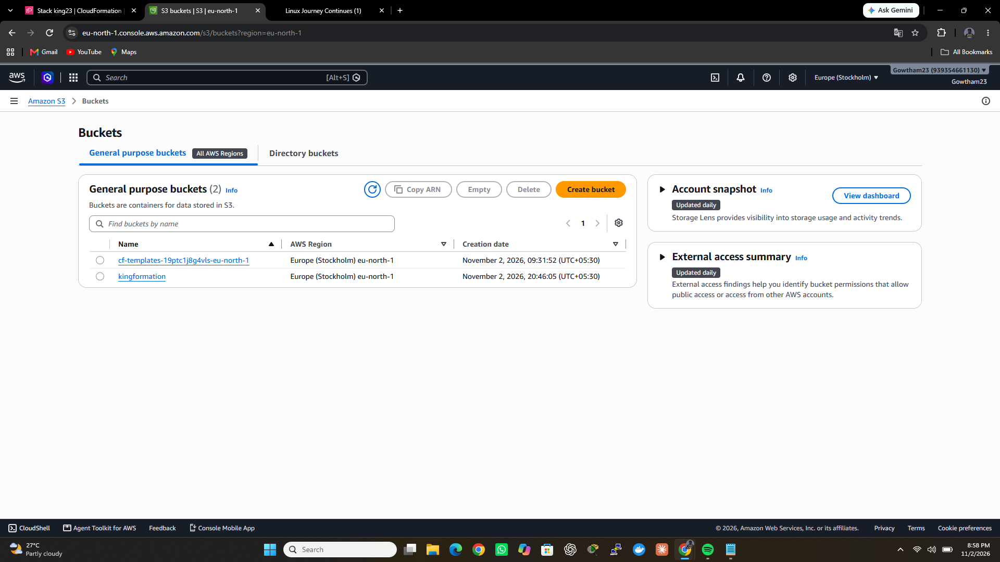

# AWS Highly Available Website using ALB, EC2 Auto Scaling & CloudFormation

## Project Overview

This project demonstrates how to deploy a highly available website on AWS using an Application Load Balancer, EC2 Auto Scaling Group, and AWS CloudFormation.

The infrastructure is created automatically using an Infrastructure as Code (IaC) template.

## AWS Architecture

**Traffic flow:**

Internet → Application Load Balancer → Target Group → EC2 Instances

The EC2 instances run across two Availability Zones to improve availability.

## AWS Services Used

- **Amazon VPC** – Creates an isolated network.
- **Public Subnets** – Hosts resources across two Availability Zones.
- **Internet Gateway** – Allows internet connectivity.
- **Application Load Balancer (ALB)** – Distributes incoming HTTP traffic.
- **Target Group** – Routes traffic to healthy EC2 instances.
- **Amazon EC2** – Hosts the website.
- **Launch Template** – Defines EC2 instance configuration.
- **Auto Scaling Group** – Maintains the required number of instances.
- **AWS CloudFormation** – Creates infrastructure using YAML.
- **Amazon S3** – Stores the CloudFormation template.
- **Amazon CloudWatch** – Provides metrics used by scaling policies.

## Infrastructure Configuration

- EC2 instance type: `t3.micro`
- Operating System: Amazon Linux 2023
- Availability Zones: 2
- Minimum instances: 2
- Desired instances: 2
- Maximum instances: 4
- CPU target tracking policy: 50%
- Health checks: Elastic Load Balancing

## Deployment Steps

1. Create an S3 bucket.
2. Upload the `cloudformation.yaml` template to S3.
3. Create a CloudFormation stack using the template.
4. Wait until the stack reaches `CREATE_COMPLETE`.
5. Verify the Application Load Balancer.
6. Check EC2 instances and Target Group health.
7. Open the ALB DNS URL to access the website.

## Project Verification

The deployment was successfully completed and verified:

- CloudFormation stack: `CREATE_COMPLETE`
- Two EC2 instances launched successfully.
- Both instances registered as healthy in the Target Group.
- Application Load Balancer successfully served the website.
- Auto Scaling Group configured with CPU target tracking.
## Project Screenshots

### Website

### EC2 Instances

### Load Balancer

### Target Group

### Auto Scaling Group

### CloudFormation Outputs

### S3 Buckets

## Future Improvements

- Add HTTPS using AWS Certificate Manager (ACM) on the ALB.
- Move EC2 instances to private subnets and use a NAT Gateway for outbound access.
- Add an RDS database for a dynamic application.
- Migrate the workload to containers using Docker and Amazon ECS.

## Cleanup

To avoid charges, delete the CloudFormation stack after testing. This removes the resources it created, and the S3 template bucket can be emptied and deleted separately.

## What I Learned

- Creating AWS infrastructure using CloudFormation YAML.
- Configuring VPC, subnets, and Internet Gateway.
- Understanding Application Load Balancer and Target Groups.
- Deploying EC2 instances using Launch Templates.
- Configuring Auto Scaling across Availability Zones.
- Understanding health checks and CPU-based scaling.
- Managing infrastructure as code.

## Project Status

**Successfully deployed and verified on AWS.**

## Author

**Gowtham K**

GitHub: https://github.com/gowthamkaws
